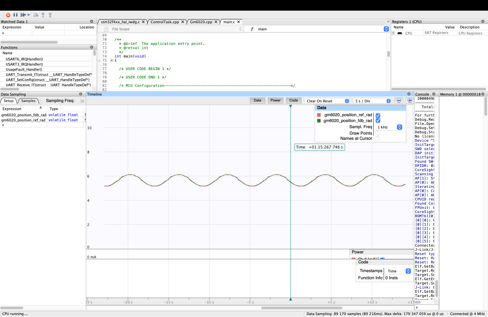
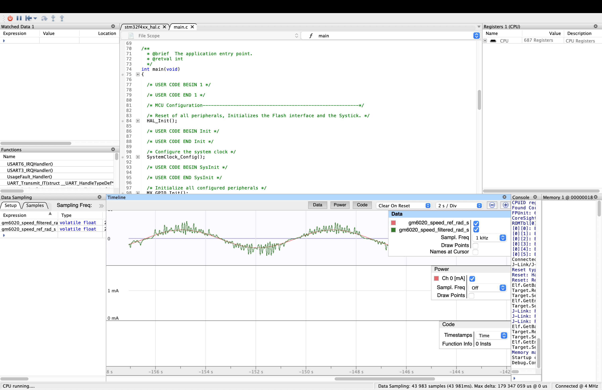

# GM6020 电机正弦曲线跟踪

基于 RoboMaster C 板（STM32F407）和 CAN 总线，实现 GM6020 电机的正弦速度跟踪与正弦位置跟踪。电机采用电流控制模式，速度环作为位置控制的内环。

## 实验参数

| 参数 | 速度模式 | 位置模式 |
| --- | ---: | ---: |
| 目标正弦频率 | 0.2 Hz | 0.2 Hz |
| 目标幅值 | 3 rad/s | 0.5 rad |
| 位置环 Kp | — | 6 |
| 速度环 Kp / Ki / Kd | 375 / 0 / 0 | 375 / 0 / 0 |
| 速度反馈滤波时间常数 | 50 ms | 50 ms |
| 静摩擦补偿指令 | 350 | 350 |
| PID 电流指令限幅 | ±1000 | ±1000 |

参数定义见 [`Tasks/inc/SineConfig.h`](Tasks/inc/SineConfig.h)。两种模式共用 `Tasks/` 中的控制实现。

## 编译

需要 ARM GNU 工具链、CMake 和 Ninja。在仓库根目录执行：

```sh
cmake -S . -B build-current-speed -G Ninja -DCMAKE_TOOLCHAIN_FILE=cmake/gcc-arm-none-eabi.cmake -DGM6020_CURRENT_CONTROL=ON -DGM6020_DEMO_MODE=0
cmake --build build-current-speed

cmake -S . -B build-current-position -G Ninja -DCMAKE_TOOLCHAIN_FILE=cmake/gcc-arm-none-eabi.cmake -DGM6020_CURRENT_CONTROL=ON -DGM6020_DEMO_MODE=1
cmake --build build-current-position
```

速度模式固件为 `build-current-speed/C_project.elf`；位置模式固件为 `build-current-position/C_project.elf`。

## 附录：实验结果

### 位置跟踪

红色为目标位置，绿色为位置反馈。



### 速度跟踪

红色为目标速度，绿色为滤波后的速度反馈。


